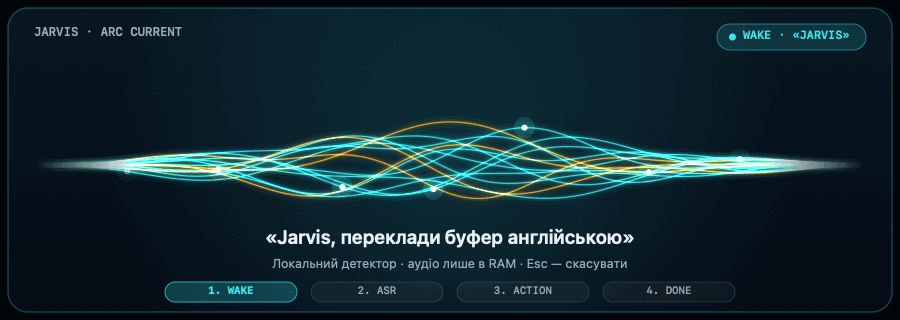
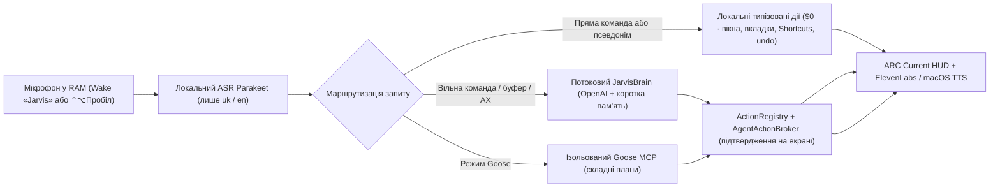
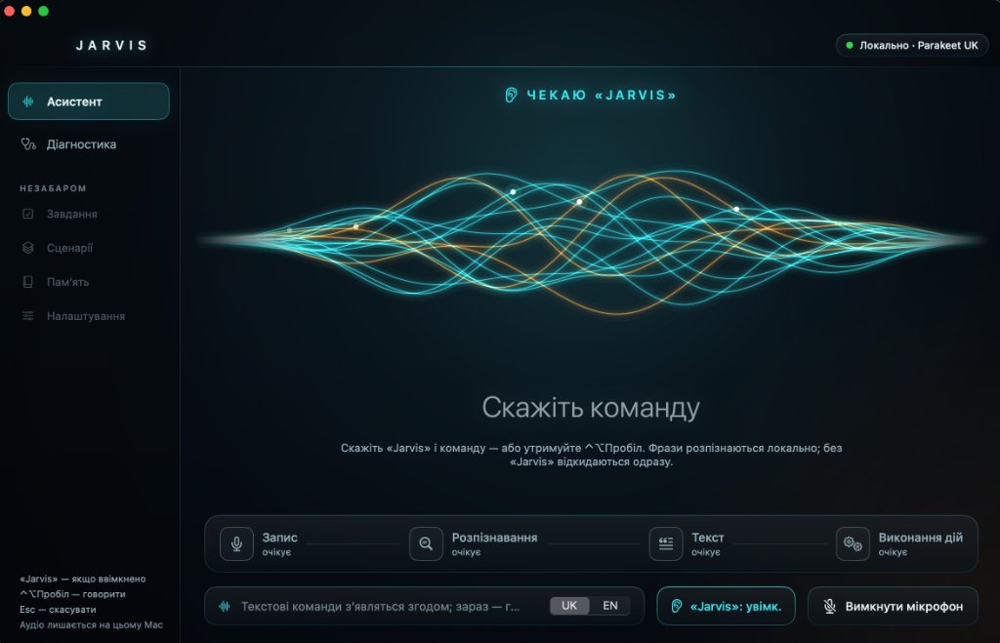

<div align="center">


# Jarvis — Особистий голосовий помічник

Нативний застосунок для macOS Apple Silicon: українська та англійська, локальне розпізнавання й реальні дії на Mac.


<br />



</div>

---

## Що вміє Jarvis зараз

| Категорія | Приклади команд (`uk` / `en`) | Як виконується |
|---|---|---|
| **Активація і контроль** | *«Jarvis, …»* · утримання `⌃⌥Пробіл` · `Esc` (скасувати) | Локальний детектор слова «Jarvis» (суворо перше слово), видиме вимкнення мікрофона |
| **Програми, вікна, звук** | *«відкрий Safari»* · *«згорни всі вікна»* · *«вікно ліворуч»* · *«гучність 40»* · *«пауза»* | Локально за `$0` через `ActionExecutor`, Accessibility і CoreAudio |
| **Браузер і нотатки** | *«нова вкладка»* · *«закрий останню вкладку»* · *«поверни вкладку»* · *«нова нотатка»* | Типізовані дії `ShortcutActions` і `WebActions` (`openURL`, `webSearch`) |
| **Елементи вікон (AX)** | *«натисни кнопку…»* · *«порахуй 2 + 2 на калькуляторі»* | Нативний Swift AX-адаптер (`uiSnapshot`, `uiPress`, `uiSetValue`) із дозволом на екрані та блоком паролів |
| **Apple Shortcuts (`P2`)** | *«запусти команду Темна тема»* · власні псевдоніми (*«підключи AirPods»*) | Суворий білий список (`0600`, порожній за замовчуванням), прямий `/usr/bin/shortcuts` без shell |
| **Буфер обміну (`P1`)** | *«переклади буфер англійською»* · *«поверни попередній буфер»* / *"restore clipboard"* | Блок `ConcealedType`, маскування ключів/JWT/PEM, підтвердження > 500 симв., RAM-відкат 120 с |
| **Швидкий `JarvisBrain`** | Вільні питання, обчислення, ланцюжки дій із контекстом розмови | Потоковий OpenAI + озвучка ElevenLabs (резерв — локальний голос macOS) |
| **Агент Goose** | Складніші плани через MCP-міст | Окремий процес із `AgentActionBroker` та панеллю **«Підтвердити один раз»** |
| **Диктування** | *«диктуй Привіт, колеги»* / *"dictate Hello team"* | Вставлення у сфокусоване текстове поле за одноразовим токеном фокусу |

---

## Як це працює (Flow)



---

## Інтерфейс ARC Current

<div align="center">

<br />
<sub><em>Реальний інтерфейс Jarvis на macOS (ARC Current: локальна модель Parakeet UK, горизонтальні світлові нитки, жива шкала етапів і миттєвий контроль мікрофона).</em></sub>
</div>

---

## Швидкий старт

Потрібні **macOS 14.5+ на Apple Silicon**, Command Line Tools, `cmake`, `git`, `curl` та `python3`.

```sh
# 1. Завантажити локальні моделі (Parakeet UK + Whisper) і зібрати бібліотеки
./scripts/setup.sh

# 2. Встановити локальний рушій активації словом «Jarvis» (sherpa-onnx)
./scripts/setup-wake.sh

# 3. Прогнати всі тести, зібрати та встановити /Applications/Jarvis.app
./scripts/build.sh

# 4. Запустити Jarvis
open /Applications/Jarvis.app
```

Після першого запуску вручну надайте дозволи в **Системні параметри → Конфіденційність і безпека**:
- **Мікрофон** — для локального захоплення голосу.
- **Універсальний доступ (Accessibility)** — для керування вікнами, вкладками, диктування й AX-дій.

> Застосунок використовує локальні моделі з цього checkout, тому не видаляйте папку проєкту після встановлення. Для `JarvisBrain` та ElevenLabs ключі зберігаються локально в macOS Keychain (у вкладці **Діагностика**).

---

## Приватність і безпека

- **Лише `uk` та `en`:** автовизначення мови вимкнене; російська мова не підтримується в жодному модулі.
- **Аудіо лише в RAM:** звук не зберігається на диск (окрім явного одноразового diagnostic WAV) і ніколи не передається в хмару.
- **Захист паролів і секретів:** заблоковано `AXSecureTextField`, менеджери паролів (`1Password`, `Bitwarden`, `Keychain` тощо) і типи буфера `ConcealedType` / `TransientType` / `AutoGeneratedType`; ключі (`sk-…`, `Bearer`, JWT, PEM) маскуються до прев'ю та логів.
- **Закрита модель дій:** жодного довільного shell — лише типізовані кейси `Action`, валідація `ActionRegistry` і підтвердження чутливих дій на екрані (`AgentApprovalPanel` / `SnapshotConsentPanel`).
- **Контроль витрат:** жорсткий ліміт OpenAI **≤ $10/міс** у `BudgetLedger` і локальний лічильник знаків ElevenLabs з автоматичним перемиканням на голос macOS.
- **Без автозапуску й телеметрії:** щоб вимкнути Jarvis, достатньо закрити застосунок; локальні дані видаляються видаленням `dist/`, `.build/` і `.runtime/`.

---

## Технічні деталі

<details>
<summary><strong>Бенчмарк ASR (50 фраз) і CLI-вимірювання</strong></summary>

- Набір фраз: [`docs/benchmarks/prompts.txt`](docs/benchmarks/prompts.txt) (25 UK, 10 EN, 15 mixed — лише українська та англійська).
- У вікні **Діагностика → Режим вимірювань** записуються локальні метрики в `.runtime/measurements/uk-en-v1.jsonl` (права `0600`, ігнорується git; аудіо не зберігається).
- Зведення (exact match, WER/CER, p50/p95):
  ```sh
  python3 scripts/analyze_measurements.py
  ```
- Прямий CLI-прогін на 16 kHz моно WAV:
  ```sh
  .build/jarvis-benchmark .runtime/parakeet-probe/model/parakeet-tdt-0.6b-v3 INPUT.wav uk 3
  ```

</details>

<details>
<summary><strong>Одноразовий діагностичний WAV</strong></summary>

У вкладці **Діагностика** кнопка **«Зберегти наступну фразу у WAV»** одноразово записує float32 mono 16 kHz файл `.runtime/diagnostics/diagnostic-<UUID>.wav` (`0600`) для перевірки мікрофона й ASR. Після одного запису, `Esc`, помилки або перезапуску режим автоматично вимикається.

</details>

<details>
<summary><strong>Сталий локальний підпис (без повторних запитів Keychain)</strong></summary>

За замовчуванням `scripts/build.sh` використовує сертифікат `Jarvis Local Signing` (якщо його немає — ad-hoc підпис). Щоб перезбірки не питали доступ до Keychain щоразу, налаштуйте локальний сертифікат за інструкцією [`docs/LOCAL-SIGNING.md`](docs/LOCAL-SIGNING.md).

</details>

<details>
<summary><strong>Дорожня карта та ліцензії</strong></summary>

- Затверджена специфікація наступних функцій (Хвилі 1–2): [`docs/superpowers/specs/2026-11-25-jarvis-next-features-spec.md`](docs/superpowers/specs/2026-11-25-jarvis-next-features-spec.md)
- Поточний task board проєкту: [`docs/product/ROADMAP-BOARD.md`](docs/product/ROADMAP-BOARD.md)
- Ліцензії та походження локальних моделей і бібліотек: [`THIRD_PARTY.md`](THIRD_PARTY.md)

</details>
