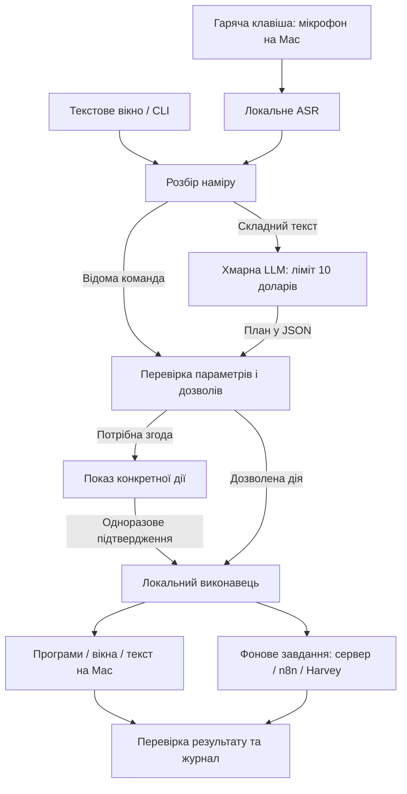

# Jarvis: рекомендоване рішення реалізації

Дата дослідження: 7 листопада 2026. Це технічна рекомендація, а не реалізований чи протестований застосунок.

## Рішення

Рекомендую **невеликий нативний застосунок Swift/AppKit для macOS 14.5, локальне розпізнавання через whisper.cpp, локальний виконавець типізованих команд і хмарну модель лише для складних текстових запитів**. WhisperKit — конкурент для порівняльного тесту розпізнавання, а не обов’язкова залежність. Домашній сервер використовувати для Harvey/n8n, черги завдань і фонової обробки. Не робити його обов’язковою ланкою голосових команд.

Користувач підтвердив: аудіо і базові команди залишаються на Mac; складні текстові запити можна передавати хмарній моделі; місячний ліміт API — **$10**. Передавання аудіо домашньому серверу окремо не погоджене й у базовому рішенні не потрібне.

Сильна сторона цього підходу — відсутність мережі та великої мовної моделі на шляху «відкрий Telegram». Вільна фраза, якої локальний розбір не зрозумів, переходить до моделі, але виконується тим самим контрольованим набором дій. Це інженерна рекомендація; ціль p95 ≤2 с ще не доведена.

## Що перевірено

| Факт | Рівень доказу |
|---|---|
| Mac працює на macOS 14.5, ARM64; активний шлях розробника — CommandLineTools | Прочитано локальними `sw_vers`, `uname -m`, `xcode-select -p` |
| M1 / 16 ГБ | Дані специфікації; не замінюють вимірювання швидкості |
| Домашній сервер доступний через збережений SSH-профіль `homeserver` | SSH-з’єднання виконане за прямим дорученням користувача |
| Сервер: Acer Nitro AN515-42, Windows 10 Home 19045, Ryzen 5 2500U, 4 ядра / 8 потоків | Read-only запити CIM через PowerShell |
| Сервер: ОС бачить 14,9 GiB RAM, вільно близько 8,5 GiB на момент перевірки; CPU load 8% | Одноразовий знімок, не навантажувальний тест |
| GPU: Radeon RX 560 Series, AdapterRAM близько 4 GiB; інтегрована Vega 8, AdapterRAM близько 1 GiB | Дані драйвера через CIM; не тест GPU inference й не точний аудит вільної VRAM |
| Диски сервера: C: 222,9 GiB / 147,9 вільно; D: 931,5 GiB / 885,7 вільно | Одноразовий знімок |
| `nvidia-smi`, `ollama`, `docker` не знайдені у PATH SSH-сесії; є `wsl.exe` | Це не доводить відсутність інсталяції в іншому середовищі |
| Сервер підключений Wi-Fi, link speed 144,4 Mbps; Ethernet disconnected | Це швидкість лінку адаптера, не вимір корисної пропускної здатності |
| 10 із 10 TCP-з’єднань до SSH-порту успішні: min 5,98 / median 9,17 / max 15,38 мс | Коротка мережева проба; не HTTP round-trip, не ASR/LLM latency і не надійний p95 |
| ICMP: 5 із 5 ping без відповіді; SSH при цьому працює | Причина ICMP-timeout не встановлена; це не доказ недоступності сервера |
| Є два процеси `node`; `wsl --list --verbose` повернув довідку замість списку | n8n та працездатний Linux-дистрибутив цим не підтверджені |
| Немає перевіреного end-to-end тесту M1/14.5 зі змішаними UK/RU/EN командами | Межа цього дослідження: моделей не встановлювали й голос не записували |

Не змінювали дозволи, конфігурацію сервера або macOS, не встановлювали моделі, не запускали автоматизації. Статус Claude Pro та облікові дані наявного n8n не перевіряли: запропонована архітектура не залежить від підписки.

## Порівняння варіантів

Оцінки нижче — архітектурні, не результати бенчмарку.

| Варіант | Швидкість і точність | Витрати | Приватність / контроль | Складність / висновок |
|---|---|---|---|---|
| Нативний Swift + локальне ASR + локальні дії + текстова хмара | Найменше залежностей для простих команд; складні залежать від мережі; змішане мовлення треба тестувати | $0 за базові команди, API в межах $10 | Аудіо на Mac, єдиний контроль виконання | Середня; **рекомендую** |
| Hammerspoon + Python + whisper.cpp | Добрий швидкий прототип; частину нативної інтеграції вже реалізовано | Локальні команди без API | Можна зробити вузький набір дій | Нижча початкова, вища ціна підтримки кількох процесів; резервний шлях |
| Повністю локальний Mac + невелика LLM | Без мережі, але LLM конкурує з ASR і робочими програмами за 16 ГБ; швидкість/точність не виміряні | Без платних викликів | Максимально локально | Додатковий режим після MVP; не запускати LLM для кожної команди |
| Mac + домашній сервер для ASR/LLM | Мережа додається до часу inference; на знайденому Ryzen/RX560 виграш не доведений | API можна скоротити; залишаються електрика й підтримка | Приватна мережа потребує захисту каналу | Для довгих задач корисно; для основного голосового контуру не рекомендую |
| Готовий відкритий асистент / повний fork | Функцій багато, але цільовий SLA не підтверджено | Залежить від бекенду | Потрібно перевіряти мікрофон, scripts, sends, approval paths | Виграш у UI може зникнути при переробці ASR/безпеки |
| Хмарний голосовий агент для всього | Може добре вести розмову; залежність від мережі й провайдера | Постійні аудіовитрати | Аудіо йде провайдеру | Не відповідає погодженій вимозі |

Hammerspoon має готові модулі керування подіями й яскравістю, але Secure Input може блокувати перехоплення клавіатури; тому фраза «з будь-якої програми» потребує перевірки винятків. [Події](https://www.hammerspoon.org/docs/hs.eventtap), [яскравість](https://www.hammerspoon.org/docs/hs.brightness.html).

## Готові проєкти: що варто запозичити

- **Murmur** — найближчий функціональний орієнтир: нативний інтерфейс, push-to-talk, локальне ASR, команди. Але поточний код вимагає Swift 6.2/Xcode 26; його заявлений deployment target macOS 14 не означає можливість зібрати проєкт на 14.5. Також є постійні дозволи на категорії дій, включно з повідомленнями, що суперечить підтвердженню кожного надсилання. [Код](https://github.com/shubhamsWEB/murmur-app), [вимоги Xcode](https://developer.apple.com/xcode/system-requirements).
- **Cursor Voice** — компактна нативна оболонка, але хмарне аудіо та широкий shell-виконавець потребують заміни. [Код](https://github.com/cursorvoice/cursor-voice).
- **Samuel** — значно ширший Electron/Realtime/ambient-проєкт; його архітектура не відповідає локальному аудіо й мінімальному фоновому навантаженню. [Код](https://github.com/sambuild04/screen-voice-agent).
- **agent-desktop** — можливий P2-адаптер дерева доступності; це інструмент керування, а не голосовий асистент чи система дозволів. [Код](https://github.com/vercel-labs/agent-desktop).

Детальний огляд із посиланнями на конкретні ревізії: [existing-solutions.md](./existing-solutions.md). Огляд джерел не є повним аудитом безпеки чи перевіркою бінарних релізів.

## Архітектура

**Оболонка.** Swift + AppKit/SwiftUI: menu bar, невелике вікно тексту, індикатор запису, список результатів, кнопка зупинки. Глобальна клавіша запускає й зупиняє AVAudioEngine. Перед показом UI запам’ятовується цільова програма/поле, щоб диктування не потрапило у власне вікно Jarvis. Запис припиняється також при Esc, sleep/lock, помилці пристрою й захисному таймауті втраченої key-up події. Прогрів моделі не означає увімкнення мікрофона.

**ASR.** Перший кандидат — whisper.cpp із Metal, багатомовні `base` і `small`; не `.en`. Модель тримати завантаженою, обробляти фрагменти під час утримання клавіші, завершувати розпізнавання після відпускання. Проміжний текст не виконується. `large-v3-turbo` — третій кандидат, якщо менші моделі недостатньо точні. Це порядок експериментів, а не рейтинг продуктивності. Проєкт документує Apple Silicon/Metal та багатомовний inference. [whisper.cpp](https://github.com/ggml-org/whisper.cpp).

**WhisperKit.** Перевірити поруч із whisper.cpp на тих самих записах. Сумісність бібліотеки, компілятора й конкретних Core ML-моделей — три окремі перевірки. Нові stateful-оптимізації Core ML потребують macOS 15+, а SpeechAnalyzer — macOS 26. Оновлення ОС не є передумовою MVP. [Core ML](https://apple.github.io/coremltools/docs-guides/source/stateful-models.html), [SpeechAnalyzer metadata](https://developer.apple.com/tutorials/data/documentation/speech/speechanalyzer.json). Докладно: [speech-options.md](./speech-options.md).

**Розуміння.** Локально: нормалізація UK/RU/EN, синоніми, назви програм, числа, заперечення, складання кількох відомих дій. Невідомі формулювання й генерацію чернеток обробляє хмарна LLM. Модель повертає лише план із реєстру доступних операцій, наприклад `app.open`, `window.tile`, `audio.setVolume`, `text.insert`, `mail.createDraft`, `workflow.start`. Валідний JSON ще не означає коректний намір; невизначену програму чи адресата треба уточнити. Жодних модельних shell-рядків.

**Виконання.** NSWorkspace/NSRunningApplication для програм і URL; AXUIElement для вікон і доступного тексту; CoreAudio для гучності; перевірені статичні Shortcuts/AppleScript — лише там, де потрібні. Apple документує запуск програм через NSWorkspace і запуск Shortcuts із CLI. [NSWorkspace](https://developer.apple.com/documentation/appkit/nsworkspace/openapplication(at:configuration:completionhandler:)), [Shortcuts CLI](https://support.apple.com/en-hk/guide/shortcuts-mac/-apd455c82f02/mac).

Яскравість і Focus — окремі capability-тести на цьому Mac. Для Focus кандидат — заздалегідь створений Shortcut; для яскравості — перевірений адаптер. Не обіцяти підтримку всіх зовнішніх моніторів. Не змінювати приватні plist налаштувань як основу рішення. Дерево AX може бути неповним або операції не підтримуватимуться програмою. [AX API](https://developer.apple.com/documentation/applicationservices/axuielement_h).

**Диктування.** Спочатку вставка через доступний AX-атрибут, якщо програма це підтримує; резервно — контрольована вставка через clipboard. Перевіряти, що фокус не змінився; не вставляти в Secure Input/паролі; не натискати Enter автоматично. Відновлювати clipboard лише якщо користувач не змінив його за цей час. Системні clipboard managers можуть перехопити текст — це слід явно показати в налаштуваннях такого режиму.

**Сховище.** SQLite: журнал операцій, стан фонових задач, витрати. Секрети — Keychain. Журнал за замовчуванням зберігає тип дії, редаговані/замасковані аргументи, час і помилки, а не повні листи, секрети чи сире аудіо. Сирий текст діагностики — лише окремий тимчасовий режим. Автозапуск — SMAppService, доступний з macOS 13. [Apple](https://developer.apple.com/documentation/servicemanagement/smappservice).

## Як використати домашній сервер

Знайдене залізо **не дає підстав вважати сервер швидшим за M1 для інтерактивного ASR/LLM**. Ryzen 2500U старіший; RX560 — не NVIDIA CUDA й не сучасна RDNA2/3. Документація готових CTranslate2-бінарників називає CPU x86-64/ARM64, NVIDIA та обмежені AMD RDNA2/3 конфігурації; RX560 до переліченого AMD-шляху не належить. Це обмеження конкретного рушія, а не доказ неможливості будь-якого GPU inference. [CTranslate2 hardware](https://opennmt.net/CTranslate2/hardware_support.html).

Можна експериментально випробувати llama.cpp CPU/Vulkan із малою квантизованою моделлю, але сумісність драйвера, доступна VRAM і швидкість не перевірені. Для коротких команд це необов’язкова додаткова складність; не закладати виграш у SLA. `faster-whisper` на CPU — кандидат для фонової транскрипції, якщо така функція з’явиться, а не автоматична заміна Metal на Mac. [llama.cpp server](https://github.com/ggml-org/llama.cpp/tree/master/tools/server), [faster-whisper](https://github.com/SYSTRAN/faster-whisper).

Пропонований розподіл:

| Mac | Домашній сервер | Хмарний API |
|---|---|---|
| Мікрофон, ASR, клавіші, UI, локальні команди, фінальна перевірка дозволів, ключі Mac | Harvey/n8n або worker поруч із чинним n8n, черга, результати пошуку, довгі розбори, необов’язковий індекс документів | Складний розбір тексту, формування чернетки, підсумок лише наданого контексту |

Перевага сервера тут — довга робота незалежно від сну Mac і розвантаження браузера/ноутбука. Не переносити чинний n8n без перевірки його поточного розміщення. Windows/WSL/container-варіант вибирається після перевірки встановленого середовища; нові компоненти під час дослідження не ставили.

Мережева проба дала медіану TCP-connect 9,17 мс — явної великої затримки на короткому знімку не видно. Це не доводить стабільності Wi-Fi під навантаженням або швидкості inference. Для тривалих задач бажано за можливості підключити сервер Ethernet; у поточному рішенні це рекомендація, а не вже зроблена зміна.

Mac звертається до вузького API сервера, а не передає довільний shell. Для майбутнього розгортання — SSH tunnel або автентифікований захищений канал; без публічного неавтентифікованого порту. API моделі на сервері, якщо його додадуть, повертатиме лише дані/план: дозволи macOS залишаються на Mac. Зникнення сервера не блокує базові команди; завдання отримують явний стан `waiting`, `failed` чи `unknown`, без автоматичного дублювання.

## Harvey, n8n і Gmail

Для Harvey пропоную контракт, який треба реалізувати: `start(params, request_id) → job_id`, `status(job_id)`, за можливості `cancel(job_id)`. Це власний API, а не готові стандартні endpoint-и n8n. Вхід автентифікується, параметри перевіряються, request_id забезпечує дедуплікацію. Відповідь «прийнято» видається після надійного збереження задачі; далі — фонова обробка та опитування статусу з Mac. Не потрібен вхідний порт на Mac. n8n має Webhook, автентифікацію й різні режими відповіді. [Документація](https://docs.n8n.io/integrations/builtin/core-nodes/n8n-nodes-base.webhook/).

Помилки до прийняття задачі повертаються як 4xx/5xx; після прийняття — як стан задачі й повідомлення користувачу. Повторення лише ідемпотентних операцій, обмежені retry/backoff. Втрата відповіді після відправлення не означає, що процес не стартував: перевірити request_id перед повтором. На стороні n8n — явні error branches та workflow-level error handler. Самі workflow поки не створені й не змінені.

Наявний Gmail-конектор у цьому чаті **не стає автоматично SDK для окремого Jarvis**. Потрібна власна OAuth-інтеграція або вузький n8n/API-адаптер із наявними належно налаштованими credentials. Читання — мінімально необхідні scopes; створення чернеток через Gmail API. Scope `gmail.compose` дозволяє і чернетки, і надсилання, тому сам OAuth не реалізує правило «тільки чернетки». [Gmail scopes](https://developers.google.com/workspace/gmail/api/auth/scopes), [drafts.create](https://developers.google.com/workspace/gmail/api/reference/rest/v1/users.drafts/create).

Для першої версії можна створювати чернетку й відкривати Gmail, а надсилати вручну в Gmail. Якщо пізніше додається надсилання із Jarvis, підтвердження прив’язується до адресатів, теми, тіла й вкладень конкретної версії чернетки; після редагування потрібне нове підтвердження. Кілька контактів «Антон» — обов’язкове уточнення, а не вгадування.

## Бюджет $10

Перший кандидат для хмарного текстового розбору — **Claude Haiku 5.5**, за доступності в API-акаунті. На перевіреній сторінці ціна для коротких запитів — $0,10 за мільйон вхідних і $0,50 за мільйон вихідних токенів. Це не вимір його затримки на нашій мережі. Модельний адаптер має дозволяти заміну провайдера. [Модель](https://platform.claude.com/docs/en/models/haiku-5-5/overview), [ціна](https://platform.claude.com/docs/en/about-claude/pricing).

Ілюстрація, не прогноз рахунку: 1000 викликів по 2000 вхідних + 200 усіх оплачуваних вихідних токенів = приблизно **$0,30** за цим тарифом. Довгі листи, thinking-токени, повторні виклики, зовнішній пошук та сторонні послуги можуть суттєво змінити суму. Обмежувати reasoning/output, контекст, кількість кроків і retry; не використовувати платний web-search для простих команд.

Технічний ліміт у Jarvis:

1. Окремий API-ключ/проєкт для обліку Jarvis; секрет у Keychain.
2. Перед запитом резервувати верхню оцінку його ціни в SQLite-транзакції; враховувати одночасні запити.
3. Після відповіді звіряти фактичний usage; при невідомому результаті не звільняти резерв навмання.
4. Попередження на $8, запас до $10; невідомий тариф/модель — блокування запиту до оновлення конфігурації.
5. При вичерпанні бюджету базові команди працюють, складний запит дає зрозумілу відмову. Не відправляти його автоматично іншому платному сервісу.

Це ліміт викликів Jarvis, не глобальна гарантія для ключа, який паралельно використовують інші програми. Окремий бюджет/ліміт провайдера — додатковий захист, якщо доступний.

## Безпека й уточнення специфікації

Єдиний виконавець перевіряє дозволи незалежно від тексту LLM. Сторінки, листи й AX-вміст — недовірені дані; вони не створюють нові повноваження. Стисла схема JSON, allowlist дій і окремий UI підтвердження зменшують ризик, але не є доказом повної невразливості до prompt injection. Потрібні тести обходів через clipboard, Enter, GUI й скрипти.

У специфікації є три конфлікти, які слід вирішити перед прийманням:

- **Системні налаштування:** гучність, яскравість і Focus — P0, але правило безпеки вимагає підтверджувати зміни системних налаштувань. До окремого рішення користувача такі дії підтверджуються. Пропозиція на майбутнє: дозволити визначений список оборотних побутових налаштувань; це ще не погоджений виняток.
- **P0 вільний запит проти P1 пошти:** у MVP вільне «напиши Антону…» може створити локальну чернетку/план; створення в Gmail — після підключення P1-адаптера. Якщо Gmail-чернетка потрібна вже для приймання MVP, інтеграцію слід включити в цей етап явно.
- **«Згорни всі» й «відкрий за 1,5 с»:** всі Spaces, непідтримувані AX-вікна, діалоги збереження й холодний запуск важких програм не мають універсальної гарантії. Не підміняти завершення дії відправленням команди ОС; фіксувати фактичний результат і межі підтримки.

Аварійна зупинка припиняє захоплення, нові кроки, власні процеси та очікування; remote cancel — best effort. Вже надісланий лист чи завершену зовнішню дію скасування не поверне. Права мікрофона/Accessibility/Automation видає користувач; Screen Recording потрібен лише для пізнішої роботи зі скріншотами.

## План перевірки і реалізації

| Етап | Результат | Умова переходу |
|---|---|---|
| 0. Короткий експеримент ASR | PTT, локальне ASR, 50 фраз, порівняння base/small і двох рушіїв | Обрана конфігурація за **точністю і повним часом**, перевірено macOS14.5; без цього SLA не обіцяємо |
| 1. Текстове керування Mac | Реєстр дій, 20 сценаріїв, confirmations, журнал, Esc | Операції працюють і підтвердження неможливо обійти; час виконання відомий без ASR |
| 2. Голосовий MVP | ASR + router + виконавець + результат | ≥90% точних простих команд; p50 ≤1 с / p95 ≤2 с на погодженому наборі або чесно зафіксований провал критерію |
| 3. Довільні формулювання | Text-only LLM, чернетки, ліміт $10 | Вимір до першої дії p50 ≤2 с / p95 ≤4 с; неправильні плани/помилки не виконуються |
| 4. Сервер/Harvey/Gmail | Фонові jobs, стан, відновлення після недоступності | Повторний запит не дублює задачу; жодне надсилання без підтвердження |
| 5. P1/P2 | Озвучення, екран, шаблони, пам’ять | Додаються по одному, з повторним тестом затримки й фонових ресурсів |

Порядок 0→1 мінімізує ризик витратити тижні на застосунок із непридатним голосовим двигуном. Точний термін розробки до ASR-експерименту та перевірки системних адаптерів був би здогадкою.

**Метод вимірювання.** Початок — реальне завершення мовлення, а не тільки key-up. Окремо: speech-end→key-up, фіналізація ASR, розбір, очікування підтвердження, dispatch, видимий результат, feedback. Використовувати монотонний час. Для холодного відкриття — поява готового вікна, а не повернення функції запуску. Для вставки — текст у цільовому полі. Для складених команд — завершення останньої дії. Час ручного підтвердження показувати окремо, не приховувати.

50 фраз: 15 українських, 10 російських, 10 англійських, 15 змішаних; серед них 20 типів дій, різні назви програм, числа й заперечення. Розділити матеріал налаштування і фінальної перевірки; виконати щонайменше 3 проходи для більш корисного p95. Окремі групи — warm/cold, звичне фонове навантаження, шум. 50 спостережень дають нестійку оцінку хвоста; не називати її виробничою гарантією. Помилки, таймаути й пропуски не викидати зі звіту; рахувати точність наміру/аргументів і частку правильних команд, що вкладаються в дедлайн. Негативні тести — окремо, не включати їх у ціль ≥90% виконаних простих команд.

Орієнтовний **бюджет проєктування**, не замір: залишити для завершення ASR приблизно 0,6–0,7 с із медіанного 1 с, решту — локальному розбору, виконанню й перевірці. Перцентилі етапів не можна просто додати й назвати end-to-end p95. Якщо точне ASR не залишає часу дії, треба змінити рушій/модель/інкрементальність або чесно переглянути SLA. Швидкий звук «почув» не підміняє виконання.

**20 початкових сценаріїв:** відкрити програму; перемкнутися; штатно закрити; сховати програму; згорнути поточне вікно; згорнути доступні вікна; ліва половина; права половина; максимізація; увімкнути fullscreen; вийти з fullscreen; встановити гучність; mute; unmute; встановити яскравість; Focus on; Focus off; відкрити URL; пошук у браузері; вставити диктований текст. Це пропозиція набору, а не вже погоджені чи реалізовані команди. Додатково тестуються складена команда, локальна чернетка з вільного запиту, невідомий адресат, відмова від підтвердження, шум/тиша, недоступний сервер і вичерпаний бюджет.

## Неочевидні способи спростити систему

1. **Особисті перевірені макроси:** після успішного виконання зберегти явно схвалену відповідність фрази типізованому плану. Наступного разу обійти LLM. Без кешування підтвердження надсилання, одноразових ID і небезпечних аргументів.
2. **Два явні режими:** звичайна клавіша — команди; інша комбінація/перемикач — диктування. Це зменшує неоднозначність «напиши…» та ризик виконати продиктований текст як інструкцію.
3. **Словник особистих назв:** програми, проєкти й контакти з кількома мовними варіантами. Поліпшення точності слотів може бути кориснішим за збільшення всієї моделі; величину ефекту треба виміряти.
4. **Паралельність із мовленням:** розпізнавання й підготовка безпечного плану під час PTT, commit лише після завершення й перевірки. Це скорочує хвіст затримки без постійного мікрофона.
5. **Сервер як worker:** довгі задачі продовжуються, коли Mac заснув; повернувшись, Jarvis підхоплює status за job_id. Не треба тягнути GPU-сервер у кожне регулювання гучності.

## Вимкнення й видалення

Перед передачею MVP потрібна перевірена інструкція: вимкнути автозапуск у Jarvis і Login Items, завершити застосунок/worker, відкликати Microphone/Accessibility/Automation/Screen Recording у System Settings, відкликати окремий OAuth/API-ключ, видалити локальні моделі/журнал за вибором користувача. Серверні tasks і n8n-адаптер вимикаються окремо; видалення Jarvis не має зупиняти сторонні workflows.

**Результат дослідження:** архітектура й початковий стек обрані; головна невизначеність — реальна точність/затримка локального ASR на голосі користувача. Сервер корисний для фонового виконання, але не підтверджений як прискорювач інтерактивного голосового контуру.
